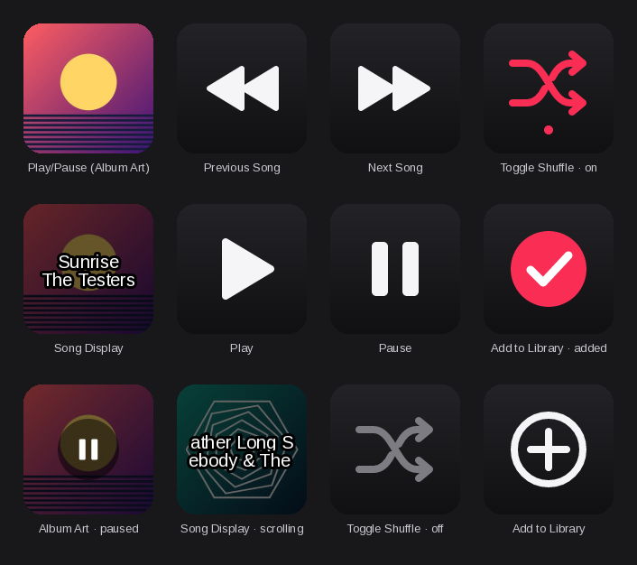

# Sidra Companion Plugin



| Action | What it does |
|---|---|
| **Play/Pause (Album Art)** | Toggles playback. The key shows the current cover: just the album art while playing; dimmed with a pause icon while paused. Hold and/or double-tap it for Next, Previous or Replay (your choice). When Sidra is closed, pressing it opens Sidra. |
| **Play** | Starts playback. |
| **Pause** | Pauses playback. |
| **Next Song** | Skips forward. |
| **Previous Song** | Goes back a song. |
| **Toggle Shuffle** | Turns shuffle on/off. The key follows Sidra's state, including changes made in Sidra itself. |
| **Add to Library** | Adds the playing song to your Apple Music library. Shows a check once the song is in your library. Needs one launch flag on Sidra — see below. |
| **Song Display** | Shows song and artist over the dimmed cover; long names scroll. Pressing it brings the Sidra window forward (configurable). |

Everything except Add to Library talks to Sidra over MPRIS (`org.mpris.MediaPlayer2.sidra` on the session bus), so it works with a stock Sidra and reacts instantly to changes made anywhere — Sidra's window, media keys, KDE/GNOME controls.

## Requirements

- OpenDeck 2.x on Linux
- Node.js 20 or newer on the host. OpenDeck runs JavaScript plugins with the system `node` (Arch: `sudo pacman -S nodejs`, Fedora: `sudo dnf install nodejs`, Debian/Ubuntu: `sudo apt install nodejs`). The Flatpak build of OpenDeck also uses the host's Node through `flatpak-spawn`.
- Sidra (any install method)

## Install

Download `com.zaldivarn.sidra.streamDeckPlugin` from the [Releases](../../releases) page, then in OpenDeck open **Plugins → Install from file** and choose it. The **Sidra** category appears in the action list.

## Enabling Add to Library

Adding to your library isn't part of MPRIS, so this one key talks to Sidra's Apple Music page through Chromium's DevTools protocol and asks MusicKit (already signed in as you) to add the song. Sidra has to expose that endpoint on localhost:

```sh
sidra --remote-debugging-port=9222 --remote-debugging-address=127.0.0.1
```

Sidra only allows one instance, so **quit it fully first** (tray icon → Quit, especially if Close to tray is on), then start it with the flags.

To make your normal launcher always do this, copy Sidra's desktop entry into your user applications folder and add the flags to its first `Exec=` line:

```sh
mkdir -p ~/.local/share/applications
cp /usr/share/applications/sidra.desktop ~/.local/share/applications/
sed -i -E '0,/^Exec=/{s|^(Exec=[^ ]+)|\1 --remote-debugging-port=9222 --remote-debugging-address=127.0.0.1|}' \
  ~/.local/share/applications/sidra.desktop
```

The copy in `~/.local/share/applications` takes precedence over the system one and survives package updates. (Snap: the entry is `/var/lib/snapd/desktop/applications/sidra_sidra.desktop` and its `Exec` starts with `env …`, so put the flags right after `/snap/bin/sidra` by hand.)

If you use a different port, set it in the Add to Library key's settings; the panel shows whether the plugin can reach Sidra's page.

**Trade-off:** while that port is open, any program running on this machine — under any user account — can drive the Sidra window, including its signed-in Apple Music session. `127.0.0.1` keeps it off the network, but it isn't per-user. On a single-user desktop that's usually acceptable; if it isn't for you, skip this key — every other action works without it.

## Settings

Select a key in OpenDeck to see its settings.

**Play/Pause (Album Art)** — while playing the key is always just the cover. *Paused icon*: a large centred pause icon (default), a small one in the corner, or none. *Dim the album art* when paused (on by default).

*Gestures* — a tap always plays/pauses. On top of that:
- **Hold** (default *Next song*): hold the key past *Hold for* (*Short* 0.35 s, *Normal* 0.5 s, *Long* 0.8 s) to run its action — one per hold.
- **Double-tap** (default *Off*): two taps within *Tap speed* (*Fast* 0.25 s, *Normal* 0.35 s, *Relaxed* 0.5 s) run its action.

Each can be *Off*, *Next song*, *Previous song* or *Replay song* (back to 0:00 of the current song; the key flashes OK since the cover doesn't change), and they can be used together — e.g. hold for Previous, double-tap for Next. The trade-off is when a single tap fires: with hold on it plays/pauses when you let go; with double-tap on it waits for the tap-speed window first; with both off it plays/pauses the moment you press. None of this applies on the *Sidra closed* screen — the press opens Sidra straight away.

*When Sidra is closed* — **Opens Sidra** (on by default): on the *Sidra closed* screen, pressing the key starts Sidra; it shows *Opening…* until Sidra is up, then switches to the album art. Only this key does this, and only while Sidra is closed — otherwise it's play/pause as usual. Sidra is started from its app-launcher entry, found the same way your desktop does (your `~/.local/share/applications/sidra.desktop` override wins, so the Add to Library port flags are kept; snap and AppImageLauncher entries are found too). The settings panel shows which entry it will use. If it can't find one, type a command into *Command* (e.g. `~/Applications/Sidra-linux-x86_64.AppImage`); it runs through `sh`. Sidra runs on its own afterwards — reloading the plugin or quitting OpenDeck doesn't close it.

**Song Display** — what to show (song + artist, artist + song, song only, song + artist + album), dimmed cover or plain background, scrolling vs. cutting off long text, scroll speed, characters per line, and what a press does (show Sidra, play/pause, nothing). Font and size come from OpenDeck's title settings for the key; if text runs off the edges at a larger size, lower *Characters / line*.

**Add to Library** — DevTools port and a live connection check.

All keys show the Sidra connection state and current track at the top of the settings panel.

## Behaviour notes

- If Sidra isn't running, art keys show a placeholder, Song Display says *Sidra closed*, and presses flash OpenDeck's alert icon (except the album-art key, which opens Sidra unless you turned that off). The plugin picks Sidra up automatically when it starts — no need to restart OpenDeck.
- Opening Sidra waits up to a minute for it to come up (Sidra only connects its media controls once Apple Music has loaded). If it fails to start or doesn't appear in time, the key flashes the alert icon and the reason is in the plugin log.
- Covers are taken from `mpris:artUrl`. Sidra publishes Apple's CDN URL first, then switches to its local cache copy (`~/.cache/sidra/artwork`); the plugin asks the CDN for a 288px rendition and handles the cached file too (including PNG covers saved under a `.jpg` name).
- Add to Library works for catalogue songs and music videos. Radio stations and shows aren't supported and show an alert. Songs you're playing *from* your library show the check straight away.
- The check on the Add to Library key is also refreshed on each track change by asking Apple whether the song is already in your library. That lookup is best-effort: if it fails, the key just shows the plus until you press it.
- Plugin log: `~/.local/share/opendeck/logs/plugins/com.zaldivarn.sidra.sdPlugin.log` (Flatpak: under `~/.var/app/me.amankhanna.opendeck/`).

## Licence

MIT — see [LICENSE](LICENSE). The Sidra logo in `assets/` keeps its own licence (below).

## Credits

The plugin and category icon is Sidra's own logo, used unchanged from the [Sidra repository](https://github.com/wimpysworld/sidra) under the [Blue Oak Model License 1.0.0](https://blueoakcouncil.org/license/1.0.0) — see `assets/NOTICE.md`. This plugin isn't affiliated with the Sidra project.

## Building and testing

```sh
npm install
npm run build     # -> com.zaldivarn.sidra.sdPlugin/ and dist/com.zaldivarn.sidra.streamDeckPlugin
npm test          # unit checks + end-to-end run (needs dbus-run-session)
```

The build bundles everything into `com.zaldivarn.sidra.sdPlugin/bin/plugin.js` with esbuild, so the installed plugin needs only Node — no `node_modules`, no native add-ons. Album art is decoded, resized and composited in pure JS.

`npm test` starts a private D-Bus session with a mock Sidra MPRIS service (modelled on Sidra's own implementation), a mock OpenDeck host, a mock DevTools endpoint running the injected script against a fake MusicKit, a local stand-in for Apple's artwork CDN, and a temporary applications folder whose `sidra.desktop` starts a stand-in Sidra process, then drives every action through the bundled plugin.

### Layout

```
src/plugin.js     action wiring and key rendering
src/mpris.js      Sidra MPRIS client (dbus-next): watch, mirror state, send commands
src/library.js    Add to Library over the DevTools protocol
src/launcher.js   find Sidra's desktop entry and start it (album-art key, Sidra closed)
src/art.js        cover loading + key compositing      src/raster.js  pixel helpers
src/png.js        tiny PNG decoder                      src/text.js    wrap / marquee
src/icons.js      SVG key art                           src/opendeck.js  SDK socket
plugin-static/pi  settings panel (one page for all actions)
assets/           Sidra logo (plugin icon) + NOTICE
build.mjs         bundle, icons, manifest, .streamDeckPlugin
```
